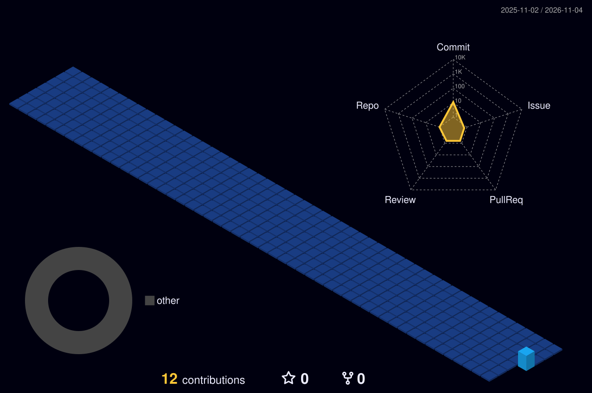

<h1>Hi There, I'm Deepak </h1>

> **Assistant Professor (Pharmacology) · M.Pharm (Pharmacology) · Ph.D. in Pharmacy (Pursuing) — bridging pharmacology research, teaching, and AI-driven innovation.**

## About Me

**Assistant Professor (Pharmacology)** with ~5 years of teaching and research experience, currently pursuing a **Ph.D. in Pharmacy**. My research focuses on **neuropharmacology** — especially **Alzheimer's disease** and natural products — and I am a member of the **Consensus AI Faculty Advisory Board** and a **Reviewer for Cureus Journal of Medical Science**.

  
  
  
  
  
  

## Academic Journey :mortar_board:

<table>
  <tr>
    <td align="center"><h2>🎓</h2><b>Ph.D. in Pharmacy</b> Pursuing</td>
    <td align="center"><h2>💊</h2><b>M.Pharm — Pharmacology</b> Maharshi Dayanand University, Rohtak 2017 – 2019 · 1st Division</td>
    <td align="center"><h2>🧪</h2><b>B.Pharm</b> Maharshi Dayanand University, Rohtak 2012 – 2016 · 1st Division</td>
    <td align="center"><h2>🪪</h2><b>Registered Pharmacist</b> Haryana State Pharmacy Council</td>
  </tr>
</table>

## Experience :briefcase:

- **Faculty Advisory Board Member** — Consensus AI · *2026 – Present*
- **Innovation Consultant** — FutureWise IT Solutions, Dubai (UAE) · *2024 – 2026*
- **Assistant Professor (Pharmacology)** — Indira Gandhi University, Meerpur · *2019 – 2024*
- **Reviewer** — Cureus Journal of Medical Science

## Skill Set :muscle:

**Core Domains**

  
  
  
  
  

**Pharmacology Specialization**

  
  
  
  
  

**Experimental & Lab Techniques**

  
  
  
  
  
  

**Computational & AI in Healthcare**

  
  
  
  
  

**Languages & Data Analysis**

<table>
  <tr>
    <td align="center"> Python</td>
    <td align="center"> R</td>
    <td align="center"> RStudio</td>
    <td align="center"> Jupyter</td>
    <td align="center"> Anaconda</td>
    <td align="center"> Markdown</td>
  </tr>
</table>

**Statistics & Scientific Software**

  
  
  
  
  
  

## Publications & Patent :page_facing_up:

- [Anti-viral Effects of *Pavetta indica* Extract and Acyclovir in STZ-induced Alzheimer's Disease in Rats](https://doi.org/10.2174/0118715303273145240110100341) — *Endocrine, Metabolic & Immune Disorders - Drug Targets*, 2024
- [Naturally Inspired Pyrimidines Analogues for Alzheimer's Disease](https://doi.org/10.2174/1570159X18666201111110136) — *Current Neuropharmacology*, 2021 (Review)
- [Risk Perception, COVID-19 Knowledge and Preventive Measures among Indian Pharmacy Students](https://doi.org/10.31782/IJCRR.2021.13304) — *IJCRR*, 2021
- **Design Patent:** AI Assisted Device for Prediction of Breast Cancer (No. 442936-001, Indian Patent Office, 2025)

## GitHub Stats :chart_with_upwards_trend:

  <picture>
    <source media="(prefers-color-scheme: dark)" srcset="./profile-3d-contrib/profile-night-view.svg" />
    <source media="(prefers-color-scheme: light)" srcset="./profile-3d-contrib/profile-green.svg" />
    
  </picture>

  <picture>
    <source media="(prefers-color-scheme: dark)" srcset="https://streak-stats.demolab.com/?user=jasaiwaldk&theme=github-dark-blue&hide_border=true&background=00000000&stroke=30363D&ring=67E8F9&fire=67E8F9&currStreakLabel=67E8F9&sideLabels=C9D1D9&dates=8B949E" />
    <source media="(prefers-color-scheme: light)" srcset="https://streak-stats.demolab.com/?user=jasaiwaldk&theme=default&hide_border=true&background=00000000&stroke=D0D7DE&ring=0F172A&fire=0F172A&currStreakLabel=0F172A&sideLabels=1F2937&dates=64748B" />
    
  </picture>

## Contribution Activity :zap:

  <a href="https://github.com/jasaiwaldk">
    <picture>
      <source media="(prefers-color-scheme: dark)" srcset="https://raw.githubusercontent.com/jasaiwaldk/jasaiwaldk/output/github-snake-dark.svg" />
      <source media="(prefers-color-scheme: light)" srcset="https://raw.githubusercontent.com/jasaiwaldk/jasaiwaldk/output/github-snake.svg" />
      
    </picture>
  </a>

## Let's Connect :handshake:

